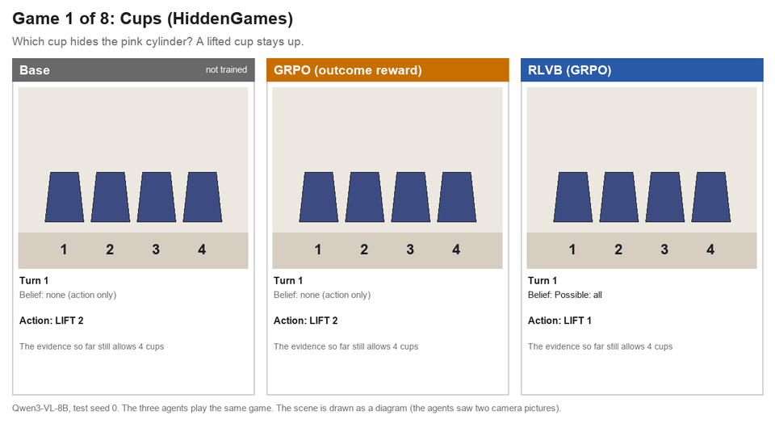

<div align="center">
<h1>RLVB: Reinforcement Learning with Verifiable Belief</h1>

<a href="assets/rlvb_vs_base_grpo.mp4"></a>
</div>

<div align="center">
<h2>RLVB: Turning Agents from Lazy Guessers into Evidence Seekers with Verifiable Beliefs as Process Reward</h2>
</div>
<div align="center">

Richmond Sin Jing Xuan<sup>1</sup>,
[Peilin Feng](https://peilin-ff.github.io/)<sup>1</sup>,
Wenbin Wang<sup>2</sup>,
[Soujanya Poria](https://soujanyaporia.github.io/)<sup>1</sup>

<sup>1</sup>[DeCLaRe Lab](https://declare-lab.github.io/), Nanyang Technological University &nbsp;&nbsp; <sup>2</sup>Independent


[](https://huggingface.co/posterior-learning)

</div>

This repository contains the official implementation and evaluation code of **RLVB: Turning Agents from Lazy Guessers into
Evidence Seekers with Verifiable Beliefs as Process Reward**.

Agents on long horizons answer too early. An end-of-episode reward cannot show which step was wrong. In many
evidence-seeking tasks, the simulator knows the rules that link the hidden answer to the evidence, so it can compute the
exact posterior after every step. Reinforcement Learning with Verifiable Beliefs (RLVB) uses this posterior to reward every
step. The agent states its belief (the set of answers that it still thinks are possible). The reward checks the belief, and
the decision to look again or to answer, against the posterior.

## ✨ Highlights

- 🎯 **A process reward at every turn**: the simulator computes the exact posterior after each step, and RLVB rewards each
  turn with it. An end-of-episode reward cannot show which step was wrong.
- 🔍 **A verifiable belief**: the agent writes a belief line (the answers that are still possible). The reward checks the
  belief line, and the decision to look again or to answer, against the exact posterior.
- 🚫 **No judge, no critic, no reward model**: the reward comes from the simulator's rules. It never pays for a lucky guess.
- 🧠 **Two learners**: RLVB (EM) (expectation maximization) and RLVB (GRPO) use the same teacher scores with a different
  update.
- 🧩 **Three benchmarks**: RoboQuest, Pro-Worlds (visual puzzles: the agent sees a large world through a small window) and
  HiddenGames. No run trains on RoboQuest or Pro-Worlds.
- 📈 **Results of the paper**: on 3 vision-language models x 3 benchmarks (2 not seen in training), RLVB improves on the base
  model in all 9 settings: +12.9 points on average with GRPO as the learner, +10.4 points with EM. GRPO and PPO with the
  outcome reward lose accuracy on average. RLVB is also better than PPO with an LLM-judge process reward, with 1.6x fewer
  GPU-hours (GRPO) and 4x fewer GPU-hours (EM). Before the evidence is sufficient, the trained agent answers on 3-6 % of turns;
  the base model answers on 8-16 % of turns.

## 🧩 Benchmarks

| Benchmark | Tasks | What is hidden | Used for |
|---|---|---|---|
| HiddenGames (`train_suite`) | 8: the 7 HiddenGames test tasks and 1 training-only task (`plearn/tasks/suites/train_suite.yaml`) | see the HiddenGames row below | training (train split) |
| RoboQuest (`test_suite/roboquest`) | 10 robot tasks in a kitchen simulator, text version; 500 test games | what the agent needs: where the targets are, a label under a vessel, which parcel is odd, ... | test only |
| Pro-Worlds (`test_suite/proworlds`) | 15 visual games (engine v6.1), normal board; 300 test games | the member of a hidden world; the window shows one site of the board | test only |
| HiddenGames (`test_suite/hidden_games`) | 7: MineSweeper (easy), MiniGrid KeyCorridor, FrozenLake (hidden goal), Sokoban (hidden target), Tabletop lamps / cups / blocks; 756 test games | the mine cells; the room of the key; the goal cell and the holes that are not next to the agent; the target square; which button lights which lamp, which cup hides the object, which block stands on a slippery base | test (test split) |

`test_suite` is the three test rows together: 32 tasks, 1,556 test games. Thinking is capped at 8,192 tokens in every test
task. The Pro-Worlds long board (65 moves) is `test_suite_long`. The sources of each environment and our changes are in
[docs/environments.md](docs/environments.md).

## 🧠 Method

- **The turn**: the agent writes its reasoning, then two lines. The belief line (`Possible: <answers>`) gives the answers
  that are still possible. The action line (`ACTION: ...`) looks for more evidence or gives the answer.
- **The teacher**: each training task has an exact teacher. The teacher does the Bayes update of the hidden state after each
  observation. It gives the correct belief line and a teacher policy for the next action (look again or answer).
- **The reward**: the teacher scores each turn: the belief line against the exact posterior, and the action against the
  teacher policy.
- **The update**: the trainer samples the agent's own turns at each history. RLVB (EM) weights the turns by their scores
  (the E-step) and fits the weighted turns (the M-step). RLVB (GRPO) uses the same samples and scores. It gives each turn its
  group-relative advantage over the other turns of the same history, with a PPO clip against the phase prior.

The equations, the algorithm and the code map are in [plearn/method/README.md](plearn/method/README.md).

## 🛠️ Installation

### Requirements

- Linux with NVIDIA GPUs. The tested environment: Python 3.12, PyTorch 2.13 (CUDA 13.0), transformers 5.17, vLLM 0.32 and
  peft 0.19.
- Attention: flash-attention 3 on Hopper GPUs. On A100 GPUs, install flash-attention 2 and set
  `PL_ATTN=flash_attention_2`.
- Node.js 22 or later for the Pro-Worlds engine (`node` on `PATH`, or `NODE_BIN`).
- A GPU with a Vulkan driver for the tabletop tasks (ManiSkill3, Vulkan / EGL).
- The RoboQuest runtime (RoboCasa simulator; `ROBOQUEST_RUNTIME`). You download the RoboCasa assets yourself.

The full steps are in [docs/install.md](docs/install.md).

### Install

```bash
git clone https://github.com/declare-lab/RLVB && cd RLVB
# install PyTorch and vLLM for your CUDA version first; then plearn from the checkout, editable (plearn reads its tasks,
# configs/ and benchmarks/ from the checkout), with the game simulators and ManiSkill3 for the tabletop tasks
pip install -e ".[games,tabletop,test]"
# RoboQuest: build its simulator runtime once (RoboCasa's kitchen assets: you download them)
(cd benchmarks/roboquest && scripts/bootstrap_simulator.sh --runtime ~/roboquest-runtime --assets download)
# in every new shell: sets ROBOQUEST_RUNTIME
source ~/roboquest-runtime/env.sh
# the base models: one folder per model under $PL_MODELS
export PL_MODELS=$HOME/models
hf download Qwen/Qwen3-VL-8B-Thinking --local-dir $PL_MODELS/Qwen3-VL-8B-Thinking
hf download Qwen/Qwen3-VL-4B-Thinking --local-dir $PL_MODELS/Qwen3-VL-4B-Thinking
hf download Qwen/Qwen3.5-4B           --local-dir $PL_MODELS/Qwen3.5-4B
```

### Check the installation

```bash
# the unit tests that need no GPU; each command ends with "OK" (some tests skip without a GPU, Node.js or PL_MODELS)
CUDA_VISIBLE_DEVICES= python -m unittest discover -s tests/method -t .
CUDA_VISIBLE_DEVICES= python -m unittest discover -s tests/tools -t .
# the registered suites; prints train_suite (8 tasks), test_suite (32 tasks) and test_suite_long (32 tasks)
python -m plearn tasks --groups
# the Pro-Worlds engine is unchanged and its rule fixtures pass
(cd benchmarks/proworlds/games/expansion-6.1 && sha256sum -c SHA256SUMS && node test.mjs --fixtures)
# a training script with DRY=1: prints the training command and the test commands, runs nothing
DRY=1 scripts/pl_qwen3vl_8b_thinking.sh
```

## 🧑‍💻 Usage

Each training script trains once on `train_suite` (50 updates, LoRA r 16), then tests `adapter_50` on `test_suite` at the
seeds 0, 1 and 2 with the test script of its model. `DRY=1` prints the commands only. `SKIP_TESTS=1` trains only. The same
scripts exist for `qwen3vl_8b_thinking` (Qwen3-VL-8B-Thinking), `qwen3vl_4b_thinking` (Qwen3-VL-4B-Thinking) and `qwen35_4b`
(Qwen3.5-4B).

### Train: RLVB (EM)

```bash
# RLVB (EM) with Qwen3-VL-8B-Thinking on GPUs 0-3 (the run file configs/train/suite_qwen3vl_8b_thinking.yaml),
# then the tests of adapter_50
PL_GPUS=0,1,2,3 scripts/pl_qwen3vl_8b_thinking.sh
# continue a stopped run from the end of update 25
python -m plearn train --config suite_qwen3vl_8b_thinking --resume_step 25
```

### Train: RLVB (GRPO)

```bash
# RLVB (GRPO) with Qwen3-VL-8B-Thinking on GPUs 0-3: the RLVB (EM) run file with --update grpo
# (configs/train/grpo_posterior_qwen3vl_8b_thinking.yaml), then the tests of adapter_50
PL_GPUS=0,1,2,3 scripts/grpo_posterior_qwen3vl_8b_thinking.sh
```

### Test a model

```bash
# a released model on test_suite, seed 0, one GPU; TURN=two_line (the default): the belief line and the action line
MODEL_REPO=posterior-learning/pl-qwen3-vl-8b-thinking SEEDS=0 EVAL_GPUS=0 scripts/eval_qwen3vl_8b_thinking.sh
# your own adapter, at the seeds 0, 1 and 2
ADAPTER=runs/suite_qwen3vl_8b_thinking/queue-suite_qwen3vl_8b_thinking/adapter_50 scripts/eval_qwen3vl_8b_thinking.sh
# the base model with the belief line ("Base (w/ belief)"), and with the action line only ("Base", TURN=one_line)
scripts/eval_qwen3vl_8b_thinking.sh
TURN=one_line scripts/eval_qwen3vl_8b_thinking.sh
# one benchmark only (roboquest, proworlds or hidden_games); EXPANSION=long tests the Pro-Worlds long board
BENCH=proworlds scripts/eval_qwen3vl_8b_thinking.sh
```

All settings and variables of the tests are in [docs/evaluation.md](docs/evaluation.md). The training settings are in
[docs/training.md](docs/training.md).

### What a run saves

| Path | Contents |
|---|---|
| `$PL_RUNS/<run>/queue-<run>/adapter_<k>` | the LoRA adapter after update k (25 and 50) |
| `$PL_RUNS/<run>/logs/` | the logs of the learner and the actor |
| `$PL_RUNS/<run>/case-<run>/` | the rollouts and the evaluations of the training |
| `$PL_RUNS/<run>/config-<run>.json` | the run's settings and command lines |
| `$PL_RUNS/eval/<tag>[-<bench>][-long][-one_line]-seed<k>/results.json` | the metrics of each task and of each group, pooled over its episodes |
| `$PL_RUNS/eval/<tag>...-seed<k>/<task>.jsonl` | one row per episode, with its turns |

`PL_RUNS` defaults to `runs`. A new start of a test with the same output folder plays only the missing episodes.

## 📦 Released models

Full models (the adapter merged into the base model) on the Hugging Face organization
[`posterior-learning`](https://huggingface.co/posterior-learning):

| Learner | Qwen3-VL-8B-Thinking | Qwen3.5-4B | Qwen3-VL-4B-Thinking |
|---|---|---|---|
| RLVB (EM) | `posterior-learning/pl-qwen3-vl-8b-thinking` | `posterior-learning/pl-qwen3.5-4b` | `posterior-learning/pl-qwen3-vl-4b-thinking` |
| RLVB (GRPO) | `posterior-learning/grpo-posterior-qwen3-vl-8b-thinking` | `posterior-learning/grpo-posterior-qwen3.5-4b` | `posterior-learning/grpo-posterior-qwen3-vl-4b-thinking` |

Test a released model with `MODEL_REPO=<repository id> scripts/eval_<model>.sh` (`TURN=two_line`, the default).

## 📏 Scoring

- **Success rate**: the share of games with a correct answer (`success` in `results.json`), in percent.
- **Overall**: for each seed, all games of a benchmark together (correct games / games), then the mean over the seeds 0, 1
  and 2.
- **Errors**: a game that fails because of the server or the environment (not the agent) is left out of the scores and
  counted as `errors`. A seed counts only when every task has 0 errors.
- **Premature answers**: `premature` counts the games with an answer before the evidence identifies the answer.

`python tools/results_cells.py <seed 0 folder> <seed 1 folder> <seed 2 folder>` gives the cells of a results table with
these rules.

## 📁 Repository layout

```text
plearn/api/              the task registry, the task, the episode contract and the agent's turn
plearn/tasks/            the tasks: their episodes, turn format and exact teachers; suites/ has train_suite and test_suite
plearn/method/           the RLVB trainer (RLVB (EM) and RLVB (GRPO)), the teacher and the estimator
plearn/models/           the model registry's resolver, the picture server and the samplers (vLLM)
plearn/evaluator.py      the evaluator (python -m plearn eval)
plearn/train.py          the training launcher (python -m plearn train)
configs/models/          the base models
configs/train/           the run files: RLVB (EM) suite_*.yaml, RLVB (GRPO) grpo_posterior_*.yaml, ablations abl_pl_4b*.yaml
scripts/                 one training script for each learner and base model, one test script for each base model
benchmarks/              the environments' own code: roboquest/, proworlds/games/expansion-6.1/, vagen/, textarena/
tools/                   merge an adapter into a full model, result cells, a KL gate, the teacher's own play
tests/                   unit tests (most run on a CPU)
docs/                    install, evaluation, training, environments
```

## 📝 Citation

```bibtex
@misc{rlvb2026,
  title  = {RLVB: Turning Agents from Lazy Guessers into Evidence Seekers with Verifiable Beliefs as Process Reward},
  author = {{Richmond Sin Jing Xuan} and Peilin Feng and Wenbin Wang and Soujanya Poria},
  year   = {2026},
  note   = {CVPR 2027 submission},
  howpublished = {\url{https://github.com/declare-lab/RLVB}}
}
```

## 📜 License

MIT ([LICENSE](LICENSE)). The vendored code keeps its own license: `benchmarks/roboquest` (MIT), `benchmarks/vagen` (MIT),
`benchmarks/textarena` (MIT).

## 🙏 Acknowledgements

We build on [vLLM](https://github.com/vllm-project/vllm) (serving). Some settings of the trainer follow
[verl](https://github.com/verl-project/verl). The environments use code from [VAGEN](https://github.com/mll-lab-nu/VAGEN) and
RAGEN (FrozenLake, Sokoban), [TextArena](https://github.com/TextArena/TextArena) (the training-only task),
[POPGym Arcade](https://pypi.org/project/popgym-arcade/) (MineSweeper), [MiniGrid](https://github.com/Farama-Foundation/Minigrid)
(KeyCorridor), [ManiSkill](https://github.com/haosulab/ManiSkill) (the tabletop scene) and [RoboCasa](https://github.com/robocasa/robocasa)
(the RoboQuest assets, which you download yourself).
